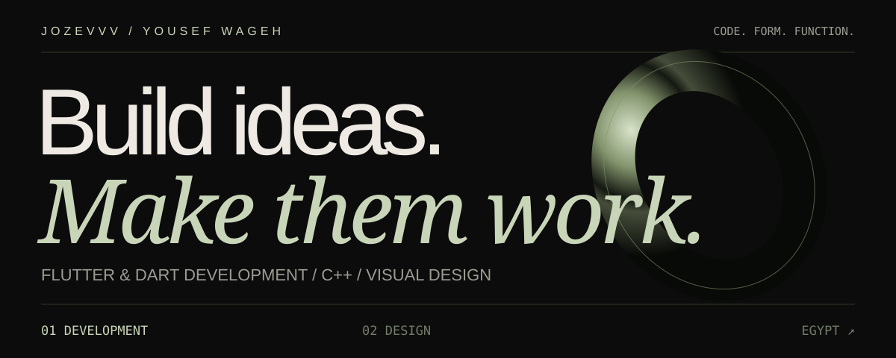

<strong>Flutter Developer · C++ · Graphic Designer</strong> 
<a href="https://jozevvv.vercel.app/">Portfolio ↗</a> &nbsp; / &nbsp;
<a href="https://www.linkedin.com/in/yousefwageh/">LinkedIn ↗</a>

## 01 / Development

I'm Yousef, a developer and graphic designer based in Egypt. I build practical applications with **Flutter and Dart**, and work on **C++ console projects**. My work includes university and client projects, with an interest in how interfaces look, how data flows and how an application works in everyday use.

### Languages & framework

 &nbsp;
 &nbsp;

**Flutter · Dart · C++**

### Data & state

 &nbsp;

**Firebase · SQLite · Riverpod · Provider**

Mobile and desktop application projects · State management · Local data storage · Authentication

## 02 / Visual design

I bring **4+ years of graphic design experience** across brand identities, logos, advertising and social media content. That background shapes the care I put into layout, typography, color and interface details.

 &nbsp;
 &nbsp;
 &nbsp;

**Photoshop · Illustrator · Figma · CapCut**

[Explore my design portfolio ↗](https://jozevvv.vercel.app/)

## 03 / Connect

I'm open to application-development opportunities that fit my experience, graphic design roles and freelance design projects.

**[Portfolio](https://jozevvv.vercel.app/)** &nbsp; / &nbsp; **[LinkedIn](https://www.linkedin.com/in/yousefwageh/)**
