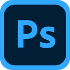
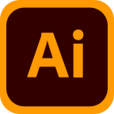

<strong>Web & Application Developer · C++ · Graphic Designer</strong> 
<a href="https://jozevvv.vercel.app/">Portfolio ↗</a> &nbsp; / &nbsp;
<a href="https://www.linkedin.com/in/yousefwageh/">LinkedIn ↗</a>

## 01 / Programming

I build websites and applications with attention to how they work and how people use them. My university and client work spans **responsive Arabic websites, content dashboards, Flutter mobile and desktop applications, and C++ console projects**.

### Web development

**HTML · CSS · JavaScript · Supabase · React · TypeScript · Vite**

Responsive layouts · Right-to-left interfaces · Content management · Authentication · Database and media integration · Static deployment

### Application development

 &nbsp;
 &nbsp;

**Flutter · Dart · C++**

Mobile and desktop interfaces · Personal inventory · Calculation and invoice workflows · Console input and data handling

### Data & state

 &nbsp;

**Firebase Authentication · Cloud Firestore · SQLite · Riverpod · Provider · Supabase**

Local persistence · Account sessions · State management · Repository and service layers

## 02 / Visual design

I bring **4+ years of graphic design experience** across brand identities, logos, advertising and social media content. That background informs my work with layout, typography, color and interface details.

 &nbsp;
 &nbsp;
 &nbsp;

**Photoshop · Illustrator · Figma · CapCut**

[Explore my design portfolio ↗](https://jozevvv.vercel.app/)

## 03 / Connect

I'm open to web and application-development opportunities that fit my experience, graphic design roles and freelance design projects.

**[Portfolio](https://jozevvv.vercel.app/)** &nbsp; / &nbsp; **[LinkedIn](https://www.linkedin.com/in/yousefwageh/)**

---

Created by **Yousef Wageh**. Original profile graphics and writing © 2026 Yousef Wageh. Tool logos and third-party assets belong to their respective owners.
