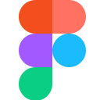

<h1 align="center">Developer & Designer</h1>

Useful tools. Clear interfaces. Thoughtful visuals.

<a href="https://jozevvv.vercel.app/">Portfolio ↗</a> &nbsp; · &nbsp; <a href="https://www.linkedin.com/in/yousefwageh/">LinkedIn ↗</a>

## Programming

I build websites and applications, from Arabic content dashboards to Flutter apps and C++ console projects. My work brings together practical development and a designer's eye for detail.

**HTML · CSS · JavaScript · Supabase · React · TypeScript · Vite · Flutter · Dart · C++ · Firebase · SQLite**

Responsive and RTL interfaces · Authentication · Content management · Local persistence · Calculation and invoice workflows

Firebase Authentication · Cloud Firestore · Riverpod · Provider

## Graphic Design

**4+ years** creating brand identities, logos, advertising and social media design. I work with layout, typography and color to give each message a clear visual direction.

 &nbsp;
 &nbsp;
 &nbsp;

**Photoshop · Illustrator · Figma · CapCut**

[Explore my design work ↗](https://jozevvv.vercel.app/)

---

Open to development opportunities that fit my project experience, design roles and freelance work.

Created by Yousef Wageh · © 2026. Tool icons via Skill Icons and their respective owners.
